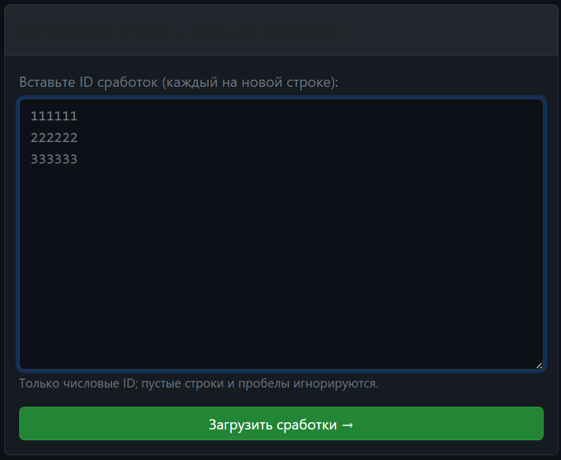
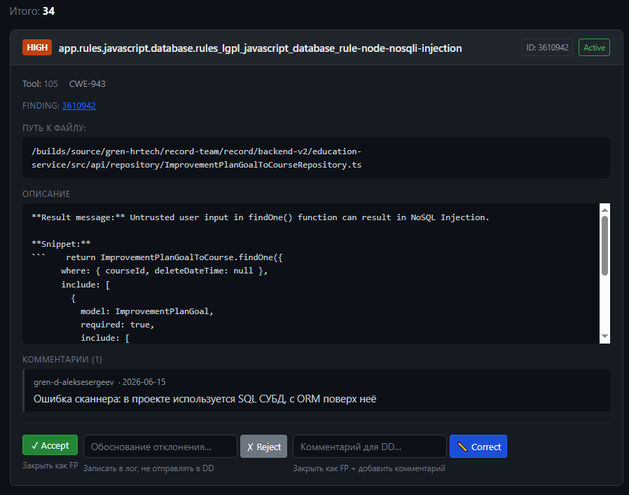
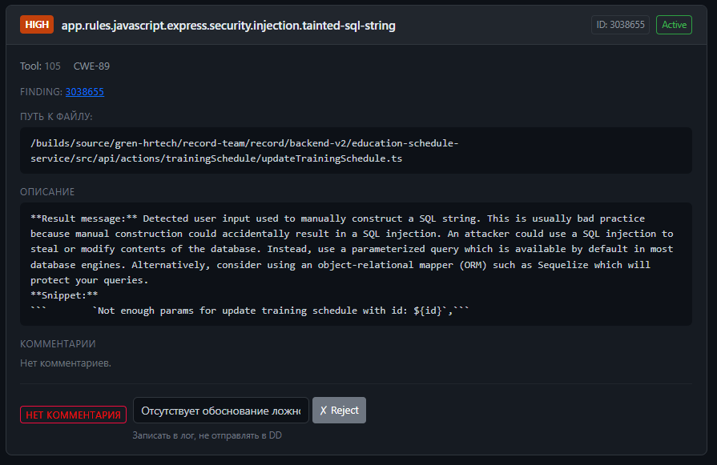

### Установка и запуск

##### При локальном запуске не через контейнер изменить 
```
pip install -r requirements.txt

# установить переменные окружения с данными ДД
$env:DD_URL="https://defectdojo.your-company.com"
$env:DD_API_KEY="your_token"
export DD_URL="https://defectdojo.your-company.com"
export DD_API_KEY="your_token"

# запуск приложения
# изменить в app.py в app.run (host="0.0.0.0"...) значение на host="127.0.0.1"
python app.py
```

##### При локальном запуске через docker
```
создать .env файл на основе .env.example
docker-compose up -d --build
```

### Как работать с приложением

##### Шаг 1. Загрузить finding по id из DD (понимает указание урл на finding вида https://ddojo.dev.rosatom.local/finding/<id>)



##### Шаг 2. Провести анализ и принять решение по статусу



Если в finding не будет указанн комментарий, то его нельзя подтвердить, кнопки accept и correct будут недоступны


##### Шаг 3. Фильтрация и массовые действия

На странице разбора есть панель фильтра — вся фильтрация и пагинация выполняются на клиенте,
дополнительных запросов к DefectDojo не делается.

* **Поиск по словам.** Запрос разбивается на слова по пробелам, сработка попадает в выдачу,
  если совпало **хотя бы одно** слово (OR). Область поиска переключается чекбоксами:
  путь к файлу (`file_path` + `component_name`), название (`title`), комментарии (`notes`),
  auto-triage (`triage_result`: explanation / verdict / action).
* **Пагинация.** 25 / 50 / 100 записей на страницу или «все».
* **Массовые действия.** Чекбокс в шапке каждой карточки; «Выделить все найденные» отмечает
  все сработки, подходящие под текущий фильтр (уже обработанные пропускаются). Нижняя панель
  применяет к выделенным Accept / Reject / Correct, запросы идут по 3 параллельно,
  в панели отображается прогресс и число ошибок.
  Выделение сохраняется при смене фильтра — перед запуском операции количество показывается
  в окне подтверждения, сбросить можно кнопкой «Снять выделение».

##### Accept в сценарии загрузки JSON

При работе по ID кнопка **Accept** просто закрывает сработку как false-positive (комментарии уже в DD).

При загрузке JSONL-файла **Accept** дополнительно переносит в DefectDojo комментарий из файла —
берётся `triage_result.explanation` и добавляется заметкой к сработке, то есть поведение аналогично
`Correct`, но текст не вводится пользователем, а берётся из JSON. Если `explanation` пустой,
кнопка Accept для такой сработки не показывается.


### Структура проекта

```
dd_triage/
├── app.py              # Flask-приложение, маршруты
├── config.py           # Настройки из переменных окружения
├── dd_client.py        # Клиент DefectDojo API
├── requirements.txt
├── .env.example        # Шаблон переменных окружения
├── logs/               # Лог-файл triаge.log
├── static/
│   ├── css/app.css     # Стили приложения (без внешних зависимостей)
│   └── js/
│       ├── index.js    # Логика экрана ввода
│       └── findings.js # Логика экрана разбора
└── templates/
    ├── index.html      # Экран ввода ID
    └── findings.html   # Экран разбора сработок
```

Регулярка для усечение лога ^\d{4}-\d{2}-\d{2}\s+\d{2}:\d{2}:\d{2},\d{3}\s+\[[^\]]+\]\s+